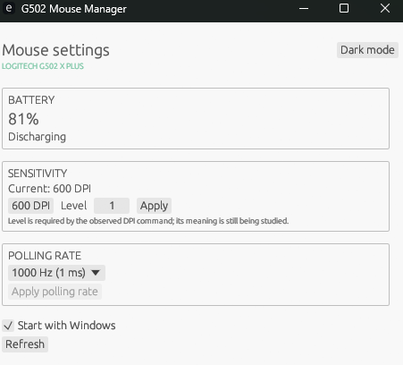

# G502 Mouse Manager

A small Windows app for the Logitech G502 X PLUS, built in Rust with HID++.



The notification area shows the mouse battery percentage:


## Features

- Battery level and charging status
- DPI and polling-rate controls, with readback after changes
- Light and dark themes
- Battery percentage in the notification area
- Optional startup with Windows

The app currently targets the G502 X PLUS receiver (`046d:c547`, slot 1). Polling options are read from the device. DPI changes require a level from 1 to 5; the meaning of this parameter is not yet fully understood. Polling changes use [libratbag's HID++ implementation](https://github.com/libratbag/libratbag/blob/master/src/hidpp20.c) as a reference and have not yet been verified on hardware. G HUB or onboard profiles may override settings.

## Getting started

Install [Rust](https://www.rust-lang.org/tools/install) and the Windows C++ build tools, then run:

```powershell
cargo run --release --bin g502-gui
```

The executable is built at `target\release\g502-gui.exe`. Startup is enabled on first launch and can be changed in the app. Move the executable to its final location before enabling startup; if you move it later, toggle startup off and on again.

Closing the window keeps the app in the notification area. Click the icon to reopen it or right-click and choose **Quit**. Windows may place the icon in the hidden icons menu.

## Command line

The CLI includes HID++ feature discovery, battery and DPI controls, and passive TShark capture tools:

```powershell
cargo run -- probe
cargo run -- battery
cargo run -- dpi get
cargo run -- dpi set 1600 --level 2
cargo run -- decode capture.txt --known-g502x --rgb
cargo run -- live <interface> <bus> <device> --all
```

To compare a setting change with an idle capture (requires TShark and USBPcap):

```powershell
cargo run -- experiment 1 1 2 --label "Idle" --seconds 30 --output idle.json
cargo run -- experiment 1 1 2 --label "Polling change" --seconds 30 --output polling.json --baseline idle.json
```

Replace the interface, bus and device numbers with those of your receiver. Captures are passive; response matches are possible correlations, not guaranteed matches. Feature indexes can change between sessions, so record a new baseline when the device mapping changes. The generated feature map and the example capture files are excluded from Git.

## Development

```powershell
cargo check --all-targets
cargo test
cargo clippy --all-targets -- -D warnings
```

RGB, button mapping, wheel configuration and onboard profiles are not implemented yet.
